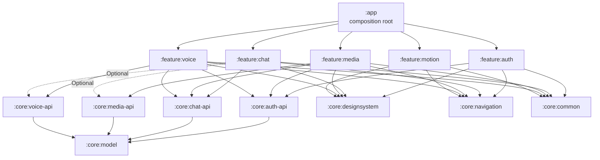

# Архитектура мессенджера «Созвездие»

**Документ:** `docs/rassanov.md`  
**Проект:** учебный мессенджер для Android, кейс «Технонаставники» / Концерн «Созвездие»  
**Команда:** 5 человек  
**Стек:** Kotlin, Jetpack Compose, Firebase (Auth / Realtime Database / Storage), Room, Hilt, Navigation Compose, Media3, Vosk  
**Статус:** предлагаемая архитектура; версии библиотек и имена участников подставляются при создании репозитория

---

## 1. Задача и ограничения

Нужно сделать MVP мессенджера для Android:

- регистрация и вход по email и паролю;
- список чатов и диалог;
- текстовые сообщения в реальном времени;
- отправка изображений и файлов;
- голосовые сообщения;
- расшифровка голосовых в текст;
- локальная история для офлайн-доступа;
- современный интерфейс и анимации.

Главное организационное ограничение: **пять человек работают одновременно**, каждый в своей ветке. При этом позже каждый должен суметь показать **только свою часть** как самостоятельный индивидуальный проект, а остальное удалить без поломок.

Из этого следуют три жёстких требования к архитектуре:

1. **Модульность.** Каждая функция — отдельный Gradle-модуль со своим владельцем.
2. **Слабая связность.** Фичи не импортируют код друг друга, а общаются через маленькие контракты (`:core:*-api`) и маршруты навигации.
3. **Удаляемость.** Чтобы убрать чужую функцию, достаточно удалить её папку, одну строку в `settings.gradle.kts` и одну строку зависимости в `:app`. Код остальных фич не меняется.

Дополнительно: проект не должен лежать в OneDrive. Gradle и Android Studio создают десятки тысяч файлов, синхронизация ломает сборку и блокирует файлы. Рабочая папка — например, `C:\Dev\SozvezdieMessenger`, Git-репозиторий — там же.

---

## 2. Главное решение

### 2.1. Многомодульный проект

```
:app                 — тонкая оболочка: Application, MainActivity, NavHost, DI, тема
:core:*              — общие стабильные библиотеки и контракты
:feature:*           — пять независимых функций, по одной на человека
:demo:*              — пять тонких приложений для индивидуальной защиты
```

Ключевая идея: **`:app` не знает конкретные фичи**. Он получает набор точек входа через DI (Hilt multibinding) и строит из них навигацию и нижнее меню. Фича сама регистрирует свои экраны. Поэтому добавление/удаление фичи не требует правок в коде `:app` — только в списке зависимостей.

### 2.2. Правила зависимостей

| Разрешено | Запрещено |
|---|---|
| `:feature:x` → `:core:common`, `:core:model`, `:core:designsystem`, `:core:navigation` | `:feature:x` → `:feature:y` |
| `:feature:x` → `:core:x-api` (свой контракт) | `:feature:x` → чужой `feature:y` |
| `:feature:x` → чужой `:core:y-api` (только интерфейсы) | `:core:*-api` → Firebase, Room, Android UI |
| `:app` → все `:feature:*` | `:app` → внутренние классы фич |
| `:demo:x` → `:feature:x` + фейки | `:demo:x` → чужие `:feature:*` |

Контракты (`:core:auth-api`, `:core:chat-api`, `:core:media-api`, `:core:voice-api`) — это **интерфейсы и модели без реализации** (плюс крошечный Hilt-модуль с `@BindsOptionalOf` для опциональных контрактов). Никакой логики, никаких зависимостей от Firebase, Room или UI. Реализации живут внутри фичи-владельца. Если фичи нет, её контракт можно заменить фейком в demo-приложении.

### 2.3. Почему это даёт независимость

- **Нет общих экранов.** Каждый экран принадлежит одной фиче.
- **Нет общих ViewModel.** Состояние живёт внутри фичи.
- **Нет прямых вызовов чужого UI.** Переход — по строковому маршруту из `:core:navigation`.
- **Нет общего файла навигации.** Каждая фича добавляет свой граф через `FeatureEntry`.
- **Нет общих строковых ресурсов.** У каждого модуля свой префикс (`auth_`, `chat_`, `media_`, `voice_`, `motion_`).

### 2.4. Альтернатива, если многомодульность окажется слишком тяжёлой

Оставить один модуль `:app`, но внутри — пакеты `feature/auth`, `feature/chat` и т.д. с такими же границами `api / data / domain / ui`. Это проще на старте, но удаление фичи становится ручным и менее надёжным. Рекомендуемый вариант — многомодульный; запасной нужен только как страховка на первые 1–2 занятия.

---

## 3. Роли и зоны ответственности

| # | Роль | Модули | Что делает | Индивидуальный проект |
|---|---|---|---|---|
| 1 | **Auth & Profile** | `:feature:auth`, `:core:auth-api` | Регистрация, вход, выход, сессия, профиль, валидация, сброс пароля | «Аутентификация и профиль в Android-мессенджере» |
| 2 | **Chat & Realtime** | `:feature:chat`, `:core:chat-api` | Список чатов, диалог, текст, realtime, Room, непрочитанные, «печатает», статус прочтения | «Realtime-ядро мессенджера с offline-first историей» |
| 3 | **Media & Files** | `:feature:media`, `:core:media-api` | Выбор изображений/файлов, сжатие, загрузка в Storage, просмотр, кэш | «Медиа-конвейер мессенджера: от галереи до облака» |
| 4 | **Voice & STT** | `:feature:voice`, `:core:voice-api` | Запись, waveform, воспроизведение, расшифровка речи, отправка голосового | «Голосовые сообщения и офлайн-распознавание речи» |
| 5 | **UI/UX & Motion** | `:core:designsystem`, `:feature:motion` | Тема, компоненты, анимации, переходы, каталог motion, доступность | «Дизайн-система и motion-дизайн мессенджера» |

Тимлид — не отдельная роль, а дополнительная нагрузка одного из пяти: он же владеет `:app`, `:core:navigation`, `:core:model`, `build-logic`, CI и правилами репозитория. Это примерно 10–15% времени; остальное он делает свою фичу.

## 4. Граф зависимостей



Стрелки `feature → feature` на схеме нет. `CHAT` видит `MEDIA_API` и `VOICE_API` только как интерфейсы и только опционально: если реализации нет, кнопки вложения и микрофона просто скрываются.

---

## 5. Структура репозитория

```
SozvezdieMessenger/
├── .github/
│   ├── CODEOWNERS                       # кто владеет какой папкой
│   ├── pull_request_template.md         # чек-лист PR
│   └── workflows/
│       └── ci.yml                       # сборка и тесты на каждый PR
├── .gitattributes                       # единые переводы строк
├── .gitignore
├── build.gradle.kts                     # корневые плагины, apply false
├── settings.gradle.kts                  # include всех модулей + build-logic
├── gradle.properties
├── gradlew
├── gradlew.bat
├── gradle/
│   ├── libs.versions.toml               # единый каталог версий
│   └── wrapper/
├── build-logic/                         # convention-плагины, чтобы не дублировать Gradle
│   ├── settings.gradle.kts
│   └── convention/
│       ├── build.gradle.kts
│       └── src/main/kotlin/
│           ├── AndroidApplicationConventionPlugin.kt
│           ├── AndroidLibraryConventionPlugin.kt
│           ├── AndroidFeatureConventionPlugin.kt
│           ├── AndroidComposeConventionPlugin.kt
│           └── JvmLibraryConventionPlugin.kt
├── app/
│   ├── build.gradle.kts
│   ├── google-services.json             # Firebase; решение о коммите — ниже
│   ├── proguard-rules.pro
│   └── src/main/
│       ├── AndroidManifest.xml
│       ├── kotlin/com/sozvezdie/messenger/
│       │   ├── MessengerApp.kt          # @HiltAndroidApp
│       │   ├── MainActivity.kt          # @AndroidEntryPoint
│       │   ├── di/AppModule.kt          # Firebase, dispatchers
│       │   └── ui/
│       │       ├── MessengerRoot.kt     # NavHost из Set<FeatureEntry>
│       │       ├── MessengerBottomBar.kt
│       │       └── StartDestination.kt
│       └── res/values/
│           ├── strings.xml              # только общие строки (app_name)
│           └── themes.xml               # splash/тема до Compose
├── core/
│   ├── common/
│   │   ├── build.gradle.kts
│   │   └── src/main/kotlin/com/sozvezdie/messenger/core/common/
│   │       ├── AppResult.kt             # Success / Failure
│   │       ├── AppDispatchers.kt
│   │       ├── AppError.kt
│   │       ├── Ids.kt
│   │       └── Time.kt
│   ├── model/
│   │   └── src/main/kotlin/.../core/model/
│   │       ├── User.kt
│   │       ├── Chat.kt
│   │       ├── Message.kt
│   │       ├── MessageContent.kt        # sealed: Text/Image/File/Voice
│   │       ├── MessageStatus.kt
│   │       ├── Attachment.kt
│   │       └── VoiceNote.kt
│   ├── designsystem/
│   │   └── src/main/kotlin/.../core/designsystem/
│   │       ├── theme/Color.kt
│   │       ├── theme/Type.kt
│   │       ├── theme/Shape.kt
│   │       ├── theme/Theme.kt
│   │       ├── component/Avatar.kt
│   │       ├── component/MessageBubble.kt
│   │       ├── component/ChatListItem.kt
│   │       ├── component/LoadingIndicator.kt
│   │       ├── component/EmptyState.kt
│   │       ├── component/ErrorState.kt
│   │       ├── component/PrimaryButton.kt
│   │       ├── component/MessengerTextField.kt
│   │       └── icon/MessengerIcons.kt
│   ├── navigation/
│   │   └── src/main/kotlin/.../core/navigation/
│   │       ├── FeatureEntry.kt          # точка входа фичи
│   │       ├── BottomTab.kt
│   │       ├── Routes.kt                # только общие маршруты
│   │       └── NavExt.kt
│   ├── auth-api/
│   │   └── src/main/kotlin/.../core/authapi/
│   │       ├── AuthRepository.kt
│   │       ├── Session.kt
│   │       └── AuthError.kt
│   ├── chat-api/
│   │   └── src/main/kotlin/.../core/chatapi/
│   │       ├── ChatRepository.kt
│   │       ├── ChatError.kt
│   │       └── SendMessageRequest.kt
│   ├── media-api/
│   │   └── src/main/kotlin/.../core/mediaapi/
│   │       ├── MediaApi.kt
│   │       └── MediaApiOptionalModule.kt
│   ├── voice-api/
│   │   └── src/main/kotlin/.../core/voiceapi/
│   │       ├── VoiceApi.kt
│   │       ├── VoicePlayer.kt
│   │       ├── VoiceRecorder.kt
│   │       ├── Transcriber.kt
│   │       └── VoiceApiOptionalModule.kt
│   └── testing/
│       └── src/main/kotlin/.../core/testing/
│           ├── FakeAuthRepository.kt
│           ├── FakeChatRepository.kt
│           ├── FakeMediaApi.kt
│           ├── FakeVoiceApi.kt
│           └── MainDispatcherRule.kt
├── feature/
│   ├── auth/
│   │   ├── build.gradle.kts
│   │   └── src/main/
│   │       ├── AndroidManifest.xml
│   │       ├── kotlin/com/sozvezdie/messenger/feature/auth/
│   │       │   ├── AuthFeatureEntry.kt
│   │       │   ├── di/AuthModule.kt
│   │       │   ├── data/FirebaseAuthRepository.kt
│   │       │   ├── data/AuthMapper.kt
│   │       │   ├── domain/SignInUseCase.kt
│   │       │   ├── domain/SignUpUseCase.kt
│   │       │   ├── ui/login/LoginScreen.kt
│   │       │   ├── ui/login/LoginViewModel.kt
│   │       │   ├── ui/register/RegisterScreen.kt
│   │       │   ├── ui/register/RegisterViewModel.kt
│   │       │   └── ui/profile/ProfileScreen.kt
│   │       └── res/values/strings.xml   # auth_*
│   ├── chat/
│   │   └── src/main/kotlin/.../feature/chat/
│   │       ├── ChatFeatureEntry.kt
│   │       ├── di/ChatModule.kt
│   │       ├── data/remote/FirebaseChatDataSource.kt
│   │       ├── data/local/ChatDatabase.kt
│   │       ├── data/local/ChatDao.kt
│   │       ├── data/local/ChatEntity.kt
│   │       ├── data/local/MessageEntity.kt
│   │       ├── data/ChatRepositoryImpl.kt
│   │       ├── data/MessageMapper.kt
│   │       ├── domain/ObserveChatsUseCase.kt
│   │       ├── domain/ObserveMessagesUseCase.kt
│   │       ├── domain/SendTextUseCase.kt
│   │       ├── domain/MarkReadUseCase.kt
│   │       ├── ui/list/ChatListScreen.kt
│   │       ├── ui/list/ChatListViewModel.kt
│   │       ├── ui/list/ChatListUiState.kt
│   │       ├── ui/conversation/ConversationScreen.kt
│   │       ├── ui/conversation/ConversationViewModel.kt
│   │       ├── ui/conversation/MessageList.kt
│   │       ├── ui/conversation/Composer.kt
│   │       └── ui/components/MessageTime.kt
│   ├── media/
│   │   └── src/main/kotlin/.../feature/media/
│   │       ├── MediaFeatureEntry.kt
│   │       ├── di/MediaModule.kt
│   │       ├── data/FirebaseMediaUploader.kt
│   │       ├── data/ImageCompressor.kt
│   │       ├── data/MediaRepository.kt
│   │       ├── domain/UploadMediaUseCase.kt
│   │       ├── ui/picker/MediaPickerScreen.kt
│   │       ├── ui/picker/MediaPickerViewModel.kt
│   │       ├── ui/viewer/ImageViewerScreen.kt
│   │       └── ui/components/AttachmentPreview.kt
│   ├── voice/
│   │   └── src/main/kotlin/.../feature/voice/
│   │       ├── VoiceFeatureEntry.kt
│   │       ├── di/VoiceModule.kt
│   │       ├── audio/AudioRecorder.kt
│   │       ├── audio/AudioPlayer.kt
│   │       ├── audio/WavWriter.kt
│   │       ├── audio/Waveform.kt
│   │       ├── transcription/VoskTranscriber.kt
│   │       ├── transcription/ModelInstaller.kt
│   │       ├── data/FirebaseVoiceUploader.kt
│   │       ├── domain/RecordVoiceUseCase.kt
│   │       ├── domain/TranscribeVoiceUseCase.kt
│   │       ├── ui/recorder/VoiceRecorderScreen.kt
│   │       ├── ui/recorder/VoiceRecorderViewModel.kt
│   │       ├── ui/recorder/WaveformView.kt
│   │       └── ui/player/VoiceMessagePlayer.kt
│   └── motion/
│       └── src/main/kotlin/.../feature/motion/
│           ├── MotionFeatureEntry.kt
│           ├── di/MotionModule.kt
│           ├── motion/MessengerMotion.kt
│           ├── motion/MessageEnter.kt
│           ├── motion/PressScale.kt
│           ├── motion/Shimmer.kt
│           ├── motion/TypingDots.kt
│           ├── motion/WaveformPulse.kt
│           └── ui/catalog/MotionCatalogScreen.kt
├── demo/
│   ├── auth/                            # отдельное приложение только с auth
│   ├── chat/
│   ├── media/
│   ├── voice/
│   └── motion/
└── docs/
    ├── rassanov.md                      # этот документ
    ├── CONTRIBUTING.md                  # правила веток и PR
    └── adr/                             # решения по архитектуре (ADR)
```

Каждый модуль повторяет стандартный layout Android: `src/main/kotlin`, `src/main/res`, `src/test/kotlin`, `src/androidTest/kotlin`, `build.gradle.kts`, `src/main/AndroidManifest.xml`.

## 6. Что лежит в модулях

### 6.1. `:core:common`

Мелкие вещи без Android UI и без Firebase:

- `AppResult<T>` — `Success` / `Failure` с типизированной ошибкой;
- `AppDispatchers` — обёртка над `Dispatchers.IO/Default/Main` для тестов;
- `AppError` — базовые ошибки (сеть, нет прав, неизвестно);
- `Ids` — генерация id сообщений/чатов;
- `Time` — единый формат времени.

### 6.2. `:core:model`

Чистые Kotlin-модели, общие для всех фич. Никаких `@Entity`, `@Serializable` Firebase и Compose — только домен.

```kotlin
data class User(
    val id: String,
    val email: String,
    val displayName: String,
    val avatarUrl: String? = null,
)

data class Chat(
    val id: String,
    val title: String,
    val lastMessage: MessageContent? = null,
    val updatedAt: Long,
    val unreadCount: Int = 0,
)

data class Message(
    val id: String,
    val chatId: String,
    val senderId: String,
    val content: MessageContent,
    val createdAt: Long,
    val status: MessageStatus = MessageStatus.SENT,
)

sealed interface MessageContent {
    data class Text(val text: String) : MessageContent
    data class Image(val url: String, val width: Int? = null, val height: Int? = null) : MessageContent
    data class File(val url: String, val name: String, val size: Long, val mime: String) : MessageContent
    data class Voice(
        val url: String,
        val durationMs: Long,
        val waveform: List<Int> = emptyList(),
        val transcript: String? = null,
    ) : MessageContent
}

enum class MessageStatus { SENDING, SENT, DELIVERED, READ, FAILED }

data class Attachment(
    val url: String,
    val mimeType: String,
    val size: Long,
)
```

### 6.3. `:core:designsystem`

Тема и переиспользуемые компоненты. Владелец — UI/UX. Остальные **пользуются, но не редактируют**.

- `theme/Color.kt` — бренд-палитра из PDF: тёмно-синий `#07254F`, красный акцент `#DD2148`, голубой `#42C9ED`, светлый фон `#F5F7FA`.
- `theme/Type.kt` — шрифт (например, Manrope или Inter), размеры, межстрочные интервалы.
- `component/MessageBubble.kt` — пузырь сообщения с состояниями `SENDING / SENT / READ / FAILED`, поддержкой текста, картинки, файла и голосового.
- `component/ChatListItem.kt` — аватар, имя, последнее сообщение, время, счётчик непрочитанных.
- `component/Avatar.kt`, `LoadingIndicator.kt`, `EmptyState.kt`, `ErrorState.kt`, `PrimaryButton.kt`, `MessengerTextField.kt`.

Важно: компоненты не знают про Firebase и ViewModel. Они принимают данные и колбэки.

### 6.4. `:core:navigation`

Единственное место, где фичи «встречаются».

```kotlin
interface FeatureEntry {
    val key: String
    val order: Int
    val startRoute: String? get() = null
    val tab: BottomTab? get() = null

    fun NavGraphBuilder.registerGraph(navController: NavHostController)
}

data class BottomTab(
    val route: String,
    @StringRes val labelRes: Int,
    val icon: ImageVector,
    val order: Int,
)
```

`Routes.kt` содержит только **межфичевые** маршруты:

```kotlin
object Routes {
    const val AUTH = "auth"
    const val CHAT_LIST = "chat/list"
    const val PROFILE = "profile"
    const val MEDIA_PICKER = "media/picker?chatId={chatId}"
    const val VOICE_RECORDER = "voice/recorder?chatId={chatId}"
    const val MOTION_CATALOG = "motion/catalog"

    const val ARG_CHAT_ID = "chatId"

    fun mediaPicker(chatId: String) = "media/picker?chatId=${Uri.encode(chatId)}"
    fun voiceRecorder(chatId: String) = "voice/recorder?chatId=${Uri.encode(chatId)}"
}
```

Внутренние экраны фичи (например, `auth/register`) живут в её собственном файле и в `Routes` не попадают.

### 6.5. Контракты `:core:*-api`

**`AuthRepository`**:

```kotlin
interface AuthRepository {
    val currentUser: Flow<User?>
    suspend fun signIn(email: String, password: String): AppResult<User>
    suspend fun signUp(email: String, password: String, displayName: String): AppResult<User>
    suspend fun signOut()
    fun requireUserId(): String
}
```

**`ChatRepository`**:

```kotlin
interface ChatRepository {
    fun observeChats(userId: String): Flow<List<Chat>>
    fun observeMessages(chatId: String): Flow<List<Message>>
    suspend fun sendText(chatId: String, text: String): AppResult<Message>
    suspend fun sendContent(chatId: String, content: MessageContent): AppResult<Message>
    suspend fun markRead(chatId: String, messageId: String)
    suspend fun setTyping(chatId: String, isTyping: Boolean)
}
```

**`MediaApi`**:

```kotlin
interface MediaApi {
    suspend fun upload(chatId: String, localUri: Uri, mimeType: String): AppResult<Attachment>
}
```

**`VoiceApi`**:

```kotlin
interface VoiceApi {
    val player: VoicePlayer
    val recorder: VoiceRecorder
    val transcriber: Transcriber
}

interface VoicePlayer {
    val playingId: StateFlow<String?>
    fun play(messageId: String, url: String)
    fun pause()
    fun stop()
}
```

### 6.6. `:feature:auth`

Экраны: `LoginScreen`, `RegisterScreen`, `ProfileScreen`.

- `FirebaseAuthRepository` реализует `AuthRepository` через `FirebaseAuth`.
- `AuthModule` (Hilt) биндит `AuthRepository` и добавляет `AuthFeatureEntry` в `Set<FeatureEntry>`.
- `AuthFeatureEntry` регистрирует граф `auth` и вкладку «Профиль».
- Сессия хранится в Firebase; при старте `currentUser` отдаёт текущего пользователя.
- Валидация email/пароля — в ViewModel, ошибки — в `AuthError`.

### 6.7. `:feature:chat`

Самый большой модуль: список чатов + диалог + realtime + Room.

- `FirebaseChatDataSource` слушает `userChats/{uid}` и `chats/{chatId}/messages`.
- `ChatDao` — Room: `observeChats()`, `observeMessages(chatId)`, `upsert`.
- `ChatRepositoryImpl`: **UI читает только Room**, а Firebase-слушатель пишет в Room. Это даёт офлайн-историю и один источник правды.
- Отправка: сначала `MessageEntity(status = SENDING)` в Room, затем push в Firebase, затем обновление на `SENT` (или `FAILED`).
- `ConversationScreen` умеет: текст, картинку, файл, голосовое, статус прочтения, «печатает…».
- Кнопки вложения и микрофона показываются только если в DI есть `Optional<MediaApi>` / `Optional<VoiceApi>`.

### 6.8. `:feature:media`

- `MediaPickerScreen` — выбор изображения через `ActivityResultContracts.PickVisualMedia` (без permissions на Android 13+).
- `ImageCompressor` — сжатие до разумного размера перед загрузкой.
- `FirebaseMediaUploader` — загрузка в `chat_files/{chatId}/{messageId}/...`, получение download URL.
- После загрузки вызывает `ChatRepository.sendContent(chatId, Image(url))` и закрывается.
- `ImageViewerScreen` — полноэкранный просмотр с зумом.
- Файлы (PDF, документы) — через `OpenDocument` и `MessageContent.File`.

### 6.9. `:feature:voice`

- `AudioRecorder` — `AudioRecord`, 16 кГц, моно, PCM 16 bit, запись в WAV.
- `Waveform` — RMS по чанкам, список амплитуд для визуализации.
- `AudioPlayer` — Media3 ExoPlayer, одно активное воспроизведение.
- `VoskTranscriber` — офлайн-распознавание русского: модель `vosk-model-small-ru` скачивается при первом запуске в `filesDir` (или кладётся в assets, если позволяет размер APK).
- `VoiceRecorderScreen` — запись, таймер, waveform, отмена/отправка.
- `VoiceMessagePlayer` — кнопка play/pause и прогресс в пузыре сообщения.
- Транскрипт сохраняется в `MessageContent.Voice.transcript` и показывается под waveform.

### 6.10. `:feature:motion`

- `MessengerMotion` — единые спецификации: `spring`, `tween`, длительности, easing.
- `MessageEnter` — появление сообщения (slide + fade + scale), stagger по индексу.
- `PressScale` — упругое нажатие на кнопки и пузыри.
- `Shimmer` — скелетон загрузки списка чатов.
- `TypingDots` — анимация «печатает…».
- `WaveformPulse` — пульсация записи голосового.
- `MotionCatalogScreen` — экран-каталог всех анимаций и компонентов. Это лицо индивидуального проекта UI/UX.
- Уважение к accessibility: при отключённых анимациях в системе (`LocalMotionDurationScale`) длительности сводятся к нулю.

### 6.11. `:app`

Тонкая оболочка:

- `MessengerApp` — `@HiltAndroidApp`.
- `MainActivity` — `@AndroidEntryPoint`, получает `Set<FeatureEntry>`.
- `MessengerRoot` — `NavHost`, собранный из фич, и нижнее меню из `tab`.
- `AppModule` — провайдеры `FirebaseAuth`, `FirebaseDatabase`, `FirebaseStorage`, `AppDispatchers`.
- Никаких импортов экранов фич. Только `FeatureEntry`.

### 6.12. `:demo:*`

Тонкие приложения для индивидуальной защиты. Каждое зависит **только от своей фичи** и общих `:core:*` (`designsystem`, `navigation`, `testing`) — чужих `:feature:*` в графе нет:

```
demo/voice/
├── build.gradle.kts
└── src/main/
    ├── AndroidManifest.xml
    └── kotlin/com/sozvezdie/messenger/demo/voice/
        ├── VoiceDemoApp.kt        # @HiltAndroidApp
        ├── MainActivity.kt        # @AndroidEntryPoint
        └── di/DemoModule.kt       # фейки Auth/Chat
```

`demo`-модули создаются не в первый день, а к занятию 5–6, когда фича готова. До этого достаточно основного `:app`.

## 7. Как фичи собираются вместе

### 7.1. Точка входа фичи

Каждая фича содержит один публичный класс — реализацию `FeatureEntry`. Всё остальное — `internal`.

```kotlin
internal class AuthFeatureEntry @Inject constructor() : FeatureEntry {

    override val key = "auth"
    override val order = 0
    override val startRoute = Routes.AUTH

    override fun NavGraphBuilder.registerGraph(navController: NavHostController) {
        navigation(startDestination = "auth/login", route = Routes.AUTH) {
            composable("auth/login") {
                LoginRoute(
                    onLoggedIn = {
                        navController.navigate(Routes.CHAT_LIST) {
                            popUpTo(0) { inclusive = true }
                        }
                    },
                    onRegister = { navController.navigate("auth/register") },
                )
            }
            composable("auth/register") {
                RegisterRoute(onDone = { navController.popBackStack() })
            }
            composable(Routes.PROFILE) {
                ProfileRoute(onLoggedOut = {
                    navController.navigate(Routes.AUTH) {
                        popUpTo(0) { inclusive = true }
                    }
                })
            }
        }
    }

    override val tab = BottomTab(
        route = Routes.PROFILE,
        labelRes = R.string.auth_tab_profile,
        icon = Icons.Outlined.Person,
        order = 90,
    )
}
```

### 7.2. Регистрация через Hilt

```kotlin
@Module
@InstallIn(SingletonComponent::class)
abstract class AuthModule {

    @Binds
    @IntoSet
    abstract fun bindFeatureEntry(impl: AuthFeatureEntry): FeatureEntry

    @Binds
    abstract fun bindAuthRepository(impl: FirebaseAuthRepository): AuthRepository
}
```

`@IntoSet` — ключевой механизм. `:app` не перечисляет фичи вручную: Hilt сам собирает `Set<FeatureEntry>` из всех модулей, которые есть в зависимостях.

### 7.3. Сборка навигации в `:app`

```kotlin
@AndroidEntryPoint
class MainActivity : ComponentActivity() {

    @Inject
    lateinit var features: Set<@JvmSuppressWildcards FeatureEntry>

    override fun onCreate(savedInstanceState: Bundle?) {
        super.onCreate(savedInstanceState)
        setContent {
            SozvezdieTheme {
                MessengerRoot(features)
            }
        }
    }
}
```

```kotlin
@Composable
fun MessengerRoot(features: Set<FeatureEntry>) {
    val navController = rememberNavController()

    val startDestination = remember(features) {
        features.firstOrNull { it.startRoute != null }?.startRoute
            ?: features.minByOrNull { it.order }?.tab?.route
            ?: error("Нет ни одной FeatureEntry")
    }
    val tabs = remember(features) {
        features.mapNotNull { it.tab }.sortedBy { it.order }
    }

    Scaffold(
        bottomBar = {
            if (tabs.isNotEmpty()) {
                MessengerBottomBar(navController, tabs)
            }
        },
    ) { padding ->
        NavHost(
            navController = navController,
            startDestination = startDestination,
            modifier = Modifier.padding(padding),
        ) {
            features.forEach { feature ->
                feature.registerGraph(navController)
            }
        }
    }
}
```

`startRoute` задаёт только auth-фича (`Routes.AUTH`), у остальных он `null` — иначе стартовый экран зависел бы от порядка `Set`. Если auth удалён (например, в demo), навигация начнётся с первой вкладки.

Нижнее меню скрывается на экранах, которых нет среди вкладок (например, на логине и в диалоге). Это делается через `currentBackStackEntryAsState()` и сравнение маршрута с `tabs.map { it.route }`.

### 7.4. Опциональные зависимости между фичами

Чтобы `:feature:chat` не падал, если `:feature:media` удалили, используем `@BindsOptionalOf`:

```kotlin
// core/media-api
@Module
@InstallIn(SingletonComponent::class)
abstract class MediaApiOptionalModule {
    @BindsOptionalOf
    abstract fun bindOptionalMediaApi(): MediaApi
}
```

```kotlin
// feature/chat
@HiltViewModel
class ConversationViewModel @Inject constructor(
    private val chatRepository: ChatRepository,
    private val mediaApi: Optional<MediaApi>,
    private val voiceApi: Optional<VoiceApi>,
) : ViewModel() {

    val canAttachFile: Boolean = mediaApi.isPresent
    val canRecordVoice: Boolean = voiceApi.isPresent
}
```

Если модуль есть — `Optional` содержит реализацию, кнопка видна. Если модуля нет — `Optional.empty()`, кнопка скрыта, сборка не падает. То же самое для `VoiceApi`.

`AuthRepository` и `ChatRepository` — обязательные: полное приложение всегда собирается с auth и chat. В demo-приложениях их заменяют фейки из `:core:testing`.

### 7.5. Как добавить новую фичу

1. Создать `feature/<name>/` по шаблону.
2. Добавить `include(":feature:<name>")` в `settings.gradle.kts`.
3. Добавить `implementation(project(":feature:<name>"))` в `app/build.gradle.kts`.
4. Написать `FeatureEntry` и Hilt-модуль.
5. Всё. `:app` и другие фичи не меняются.

### 7.6. Как удалить фичу

1. Удалить папку `feature/<name>/`.
2. Удалить строку `include(":feature:<name>")` из `settings.gradle.kts`.
3. Удалить строку `implementation(project(":feature:<name>"))` из `app/build.gradle.kts`.
4. Если фича была вкладкой — она исчезнет из меню автоматически.
5. Если её контракт был обязательным для другой фичи — заменить реализацию фейком или сделать контракт опциональным.

Для индивидуальной защиты вместо удаления из полного проекта используется `:demo:<name>` — там чужих фич просто нет в графе зависимостей.

---

## 8. Три главных сценария

### 8.1. Текстовое сообщение

```
ConversationScreen
  → ConversationViewModel.sendText(text)
  → ChatRepository.sendText(chatId, text)
  → Room: INSERT MessageEntity(status = SENDING)
  → Firebase: chats/{chatId}/messages.push(...)
  → Room: UPDATE status = SENT
  → Flow из Room обновляет UI
```

Параллельно слушатель Firebase получает сообщения других участников и делает `upsert` в Room. UI никогда не читает Firebase напрямую — только Room. Это даёт офлайн-историю и предсказуемые тесты.

### 8.2. Изображение

```
Composer: кнопка «скрепка»
  → navController.navigate(Routes.mediaPicker(chatId))
  → MediaPickerScreen (feature:media)
  → PickVisualMedia → Uri
  → ImageCompressor → сжатый файл
  → Firebase Storage: chat_files/{chatId}/{messageId}.jpg
  → ChatRepository.sendContent(chatId, MessageContent.Image(url))
  → popBackStack()
  → сообщение появляется в диалоге через Room/Firebase
```

`feature:chat` не импортирует `MediaPickerScreen`. Он знает только маршрут `Routes.MEDIA_PICKER` и контракт `MediaApi`.

### 8.3. Голосовое с расшифровкой

```
Composer: кнопка «микрофон»
  → navController.navigate(Routes.voiceRecorder(chatId))
  → VoiceRecorderScreen (feature:voice)
  → AudioRecord → WAV + waveform
  → VoskTranscriber → transcript
  → Firebase Storage: chat_files/{chatId}/{messageId}.wav
  → ChatRepository.sendContent(
        chatId,
        MessageContent.Voice(url, durationMs, waveform, transcript)
    )
  → popBackStack()
```

В диалоге `MessageBubble` показывает кнопку play, waveform и текст расшифровки, но сам ничего не воспроизводит: он получает `isPlaying` и `onPlayClick` снаружи. `ConversationViewModel` берёт `Optional<VoiceApi>` и вызывает `VoicePlayer.play(messageId, url)`; если voice-фичи нет — `Optional.empty()`, кнопка play скрыта.

## 9. Данные

### 9.1. Firebase Realtime Database

```
users/{uid}
  displayName, email, avatarUrl, createdAt, lastSeen

chats/{chatId}
  title, createdAt, updatedAt
  lastMessage: { type, text, senderId, createdAt }
  members/{uid}: { joinedAt, lastReadAt }
  messages/{messageId}
    senderId, type, text, url, durationMs, waveform, transcript, createdAt, status

userChats/{uid}/{chatId}: true
typing/{chatId}/{uid}: true
presence/{uid}: { online, lastSeen }
```

Почему так:

- `userChats` — быстрый список чатов пользователя без запроса по всем чатам;
- `lastMessage` — денормализация для списка чатов, чтобы не читать всю переписку;
- `members/{uid}/lastReadAt` — простая отметка «прочитано» на уровне чата, без записи статуса в каждое сообщение;
- `typing` — эфемерная ветка, её можно чистить при выходе.

### 9.2. Room

```kotlin
@Entity(tableName = "chats")
data class ChatEntity(
    @PrimaryKey val id: String,
    val title: String,
    val lastMessageText: String?,
    val updatedAt: Long,
    val unreadCount: Int,
)

@Entity(
    tableName = "messages",
    indices = [Index("chatId", "createdAt")],
)
data class MessageEntity(
    @PrimaryKey val id: String,
    val chatId: String,
    val senderId: String,
    val type: String,
    val text: String?,
    val mediaUrl: String?,
    val durationMs: Long?,
    val waveform: String?,       // JSON-массив
    val transcript: String?,
    val createdAt: Long,
    val status: String,
    val localUri: String?,       // для непрочитанных/неотправленных
)
```

Правила:

- UI читает `Flow` из Room.
- Firebase-слушатель делает `upsert` в Room.
- Отправка сначала пишет `SENDING`, потом обновляет статус.
- Для миграций — `version` и `Migration`; `fallbackToDestructiveMigration()` только в debug.
- Кэш изображений — Coil, отдельно от Room.

### 9.3. Firebase Storage

```
chat_files/{chatId}/{messageId}.{ext}
avatars/{uid}.jpg
```

Правила на MVP: `auth != null`. Для реального продукта нужно проверять членство в чате; в Storage Rules нельзя прочитать RTDB, поэтому либо подписывать URL, либо использовать Cloud Functions (платный Blaze). Для учебного проекта достаточно `auth != null` + закрытые правила на запись.

### 9.4. Правила RTDB (пример)

```json
{
  "rules": {
    "users": {
      "$uid": {
        ".read": "auth != null",
        ".write": "auth.uid === $uid"
      }
    },
    "chats": {
      "$chatId": {
        ".read": "auth != null && data.child('members').child(auth.uid).exists()",
        ".write": "auth != null && (data.child('members').child(auth.uid).exists() || newData.child('members').child(auth.uid).exists())"
      }
    },
    "userChats": {
      "$uid": {
        ".read": "auth.uid === $uid",
        ".write": "auth.uid === $uid"
      }
    }
  }
}
```

Это не production-правила, а учебный минимум. Перед защитой стоит проверить, что чужой пользователь не читает чат.

---

## 10. Сборка проекта

### 10.1. `settings.gradle.kts`

```kotlin
pluginManagement {
    includeBuild("build-logic")
    repositories {
        google()
        mavenCentral()
        gradlePluginPortal()
    }
}

dependencyResolutionManagement {
    repositoriesMode.set(RepositoriesMode.FAIL_ON_PROJECT_REPOS)
    repositories {
        google()
        mavenCentral()
    }
}

rootProject.name = "SozvezdieMessenger"

include(
    ":app",

    ":core:common",
    ":core:model",
    ":core:designsystem",
    ":core:navigation",
    ":core:auth-api",
    ":core:chat-api",
    ":core:media-api",
    ":core:voice-api",
    ":core:testing",

    ":feature:auth",
    ":feature:chat",
    ":feature:media",
    ":feature:voice",
    ":feature:motion",

    // demo-модули добавляются к защите:
    // ":demo:auth",
    // ":demo:chat",
    // ":demo:media",
    // ":demo:voice",
    // ":demo:motion",
)
```

### 10.2. `gradle/libs.versions.toml`

Пример; версии нужно обновить под актуальные на момент создания проекта:

```toml
[versions]
agp = "8.9.2"
kotlin = "2.1.20"
ksp = "2.1.20-1.0.32"
composeBom = "2025.04.01"
hilt = "2.56.2"
firebaseBom = "33.12.0"
room = "2.7.1"
navigation = "2.8.9"
coil = "3.1.0"
media3 = "1.6.1"
coroutines = "1.10.1"
vosk = "0.3.47"

[libraries]
androidx-compose-bom = { module = "androidx.compose:compose-bom", version.ref = "composeBom" }
androidx-compose-ui = { module = "androidx.compose.ui:ui" }
androidx-compose-material3 = { module = "androidx.compose.material3:material3" }
androidx-compose-tooling = { module = "androidx.compose.ui:ui-tooling" }
androidx-navigation-compose = { module = "androidx.navigation:navigation-compose", version.ref = "navigation" }
hilt-android = { module = "com.google.dagger:hilt-android", version.ref = "hilt" }
hilt-compiler = { module = "com.google.dagger:hilt-android-compiler", version.ref = "hilt" }
hilt-navigation-compose = { module = "androidx.hilt:hilt-navigation-compose", version = "1.2.0" }
firebase-bom = { module = "com.google.firebase:firebase-bom", version.ref = "firebaseBom" }
firebase-auth = { module = "com.google.firebase:firebase-auth-ktx" }
firebase-database = { module = "com.google.firebase:firebase-database-ktx" }
firebase-storage = { module = "com.google.firebase:firebase-storage-ktx" }
room-runtime = { module = "androidx.room:room-runtime", version.ref = "room" }
room-ktx = { module = "androidx.room:room-ktx", version.ref = "room" }
room-compiler = { module = "androidx.room:room-compiler", version.ref = "room" }
coil-compose = { module = "io.coil-kt.coil3:coil-compose", version.ref = "coil" }
media3-exoplayer = { module = "androidx.media3:media3-exoplayer", version.ref = "media3" }
vosk-android = { module = "com.alphacephei:vosk-android", version.ref = "vosk" }
kotlinx-coroutines-android = { module = "org.jetbrains.kotlinx:kotlinx-coroutines-android", version.ref = "coroutines" }
```

Hilt и Room подключаются через **KSP**, не через kapt: `ksp(libs.hilt.compiler)`, `ksp(libs.room.compiler)`.

### 10.3. Convention-плагины

Пять человек не должны одновременно править `compileSdk`, `minSdk`, `jvmTarget` и настройки Compose. Это выносится в `build-logic`:

```kotlin
// build-logic/convention/src/main/kotlin/AndroidFeatureConventionPlugin.kt
class AndroidFeatureConventionPlugin : Plugin<Project> {
    override fun apply(target: Project) = with(target) {
        pluginManager.apply("com.android.library")
        pluginManager.apply("org.jetbrains.kotlin.android")
        pluginManager.apply("org.jetbrains.kotlin.plugin.compose")
        pluginManager.apply("com.google.devtools.ksp")
        pluginManager.apply("dagger.hilt.android.plugin")

        extensions.configure<LibraryExtension> {
            compileSdk = 35
            defaultConfig.minSdk = 23
            compileOptions {
                sourceCompatibility = JavaVersion.VERSION_17
                targetCompatibility = JavaVersion.VERSION_17
            }
            buildFeatures.compose = true
            resourcePrefix = project.name + "_"   // auth_, chat_, media_ ...
        }

        dependencies {
            add("implementation", platform(libs.findLibrary("androidx-compose-bom").get()))
            add("implementation", libs.findLibrary("androidx-compose-ui").get())
            add("implementation", libs.findLibrary("androidx-compose-material3").get())
            add("implementation", libs.findLibrary("hilt-android").get())
            add("ksp", libs.findLibrary("hilt-compiler").get())
        }
    }
}
```

Тогда `feature/chat/build.gradle.kts` выглядит коротко:

```kotlin
plugins {
    id("messenger.android.feature")
}

android {
    namespace = "com.sozvezdie.messenger.feature.chat"
}

dependencies {
    implementation(project(":core:common"))
    implementation(project(":core:model"))
    implementation(project(":core:designsystem"))
    implementation(project(":core:navigation"))
    implementation(project(":core:auth-api"))
    implementation(project(":core:chat-api"))
    implementation(project(":core:media-api"))
    implementation(project(":core:voice-api"))

    implementation(libs.androidx.navigation.compose)
    implementation(libs.hilt.navigation.compose)
    implementation(libs.room.runtime)
    implementation(libs.room.ktx)
    ksp(libs.room.compiler)

    testImplementation(project(":core:testing"))
}
```

### 10.4. `:app/build.gradle.kts`

```kotlin
plugins {
    id("messenger.android.application")
    id("com.google.gms.google-services")
}

android {
    namespace = "com.sozvezdie.messenger"
    defaultConfig {
        applicationId = "com.sozvezdie.messenger"
        minSdk = 23
        targetSdk = 35
        versionCode = 1
        versionName = "1.0"
    }
}

dependencies {
    implementation(project(":feature:auth"))
    implementation(project(":feature:chat"))
    implementation(project(":feature:media"))
    implementation(project(":feature:voice"))
    implementation(project(":feature:motion"))

    implementation(project(":core:common"))
    implementation(project(":core:model"))
    implementation(project(":core:designsystem"))
    implementation(project(":core:navigation"))
}
```

`google-services.json` кладётся в `app/`. Для demo-приложений — либо отдельные приложения в Firebase с их package name, либо фейки без Firebase.

---

## 11. GitHub: как работать впятером

### 11.1. Ветки

```
main                      # защищённая, всегда зелёная
dev/<name>                # личная долгоживущая ветка (опционально)
feat/<name>/<module>-<task>  # короткая ветка под задачу
fix/<name>/<module>-<bug>
```

Рекомендация: **не держать пять долгоживущих веток**. Чем дольше ветка живёт, тем больше конфликтов. Схема:

1. Каждый делает короткую ветку от `main`.
2. PR → ревью → merge в `main` в тот же день или через день.
3. Личная `dev/<name>` нужна только если хочется собрать несколько задач вместе; вливать её в `main` лучше маленькими PR, а не одним большим.

Имена веток: `feat/auth/login-screen`, `feat/voice/vosk-transcriber`, `feat/ui/message-bubbles`.

### 11.2. CODEOWNERS

```
# Глобальное — тимлид
/settings.gradle.kts        @lead
/build.gradle.kts           @lead
/gradle/libs.versions.toml  @lead
/build-logic/               @lead
/.github/                   @lead
/app/                       @lead

# Ядро
/core/common/               @lead
/core/model/                @lead
/core/navigation/           @lead
/core/designsystem/         @ui
/core/testing/              @lead

# Контракты
/core/auth-api/             @auth
/core/chat-api/             @chat
/core/media-api/            @media
/core/voice-api/            @voice

# Фичи
/feature/auth/              @auth
/feature/chat/              @chat
/feature/media/             @media
/feature/voice/             @voice
/feature/motion/            @ui
```

GitHub автоматически назначает ревьюера по CODEOWNERS. Чужой модуль нельзя смержить без согласия владельца. Имена `@auth`, `@chat` и т.д. заменить на реальные GitHub-логины.

### 11.3. Правила, которые предотвращают конфликты

1. **Один модуль — один владелец.** Не редактируй чужой модуль без PR и ревью.
2. **Общие файлы меняет только тимлид:** `settings.gradle.kts`, `libs.versions.toml`, `app/build.gradle.kts`, CI.
3. **Ресурсы с префиксом:** `auth_login_title`, `chat_send`, `voice_record`. Никаких `title`, `button_ok` — они столкнутся при merge.
4. **Пакеты с уникальным именем:** `...feature.auth`, `...feature.chat`. Никаких общих `utils` в фичах.
5. **Никаких `import` из чужой фичи.** Только `:core:*-api` и `:core:navigation`.
6. **Маленькие PR:** один модуль, одна задача, до ~400 строк. Большой PR невозможно нормально отревьювить.
7. **Rebase перед PR:** `git fetch origin && git rebase origin/main`. Не merge `main` в свою ветку без необходимости.
8. **Форматирование:** Spotless/ktlint в CI. Это убирает «шумовые» диффы из-за пробелов.
9. **`.gitattributes`:** `* text=auto`, `*.bat text eol=crlf`, `*.sh text eol=lf`, `*.kt text eol=lf`. Иначе Windows и Linux будут переписывать файлы целиком.
10. **Не коммитить:** `.idea/`, `local.properties`, `build/`, `.gradle/`, `*.apk`, `*.jks`, `*.keystore`.

`google-services.json` для учебного проекта можно закоммитить в приватный репозиторий, чтобы у всех собиралось. Ключи в нём не секретны, но правила Firebase должны быть закрыты. Если репозиторий публичный — лучше не коммитить и передавать файл отдельно.

### 11.4. PR-шаблон

```markdown
## Что сделано
- ...

## Модуль
- [ ] Изменения только в моём модуле
- [ ] Я не менял `core` без согласования
- [ ] Я не менял чужие фичи

## Как проверить
1. ...
2. ...

## Скриншот / видео
...

## Чек-лист
- [ ] `./gradlew :app:assembleDebug`
- [ ] `./gradlew :feature:<name>:testDebugUnitTest`
- [ ] Нет новых `TODO` без issue
```

### 11.5. CI

`.github/workflows/ci.yml`:

```yaml
name: CI

on:
  pull_request:
  push:
    branches: [main]

jobs:
  build:
    runs-on: ubuntu-latest
    steps:
      - uses: actions/checkout@v4
      - uses: actions/setup-java@v4
        with:
          distribution: temurin
          java-version: 17
      - uses: gradle/actions/setup-gradle@v4
      - run: chmod +x gradlew
      - run: ./gradlew :app:assembleDebug :app:testDebugUnitTest :app:lintDebug --stacktrace
```

Что проверяет CI:

- проект собирается на чистой машине;
- unit-тесты проходят;
- lint не находит критичных ошибок;
- нет случайных изменений в чужих модулях (это уже задача ревью).

Instrumentation-тесты на эмуляторе в CI — опционально: долго и капризно. Их можно запускать локально перед защитой.

### 11.6. Коммиты

Формат: `type(scope): short description`.

```
feat(auth): add login screen
feat(chat): observe messages from room
fix(voice): stop recorder on permission deny
refactor(ui): extract message bubble
docs(architecture): add module map
test(media): cover image compression
```

Типы: `feat`, `fix`, `refactor`, `test`, `docs`, `chore`, `perf`.

### 11.7. Definition of Done для PR

- Сборка зелёная.
- Тесты на новую логику есть.
- Нет изменений в чужих модулях.
- Нет закомментированного кода и отладочных `println`.
- Скриншот/видео для UI-изменений.
- README/документация обновлены, если поменялся контракт.

---

## 12. Индивидуальная защита: оставить только свою функцию

### 12.1. Идея

Полный проект `:app` содержит все пять фич. Для индивидуальной защиты каждый собирает **отдельное приложение** `:demo:<name>`, в котором есть только его фича и фейки недостающих зависимостей. Это честно: в demo-графе просто нет чужого кода.

### 12.2. Что входит в demo

| Demo | Зависит от | Фейки | Что показывает |
|---|---|---|---|
| `:demo:auth` | `:feature:auth`, `:core:designsystem`, `:core:navigation`, `:core:testing` | заглушка после входа | регистрация, вход, профиль, выход |
| `:demo:chat` | `:feature:chat`, `:core:designsystem`, `:core:navigation`, `:core:testing` | `FakeAuthRepository`, `FakeMediaApi`, `FakeVoiceApi` | список чатов, диалог, realtime (эмуляция), Room |
| `:demo:media` | `:feature:media`, `:core:designsystem`, `:core:navigation`, `:core:testing` | `FakeAuthRepository`, `FakeChatRepository` | выбор, сжатие, загрузка, просмотр |
| `:demo:voice` | `:feature:voice`, `:core:designsystem`, `:core:navigation`, `:core:testing` | `FakeAuthRepository`, `FakeChatRepository` | запись, waveform, play, расшифровка |
| `:demo:motion` | `:feature:motion`, `:core:designsystem`, `:core:navigation` | не нужны | каталог анимаций и компонентов |

`feature:chat` в demo видит `Optional<MediaApi>` и `Optional<VoiceApi>` с фейками — кнопки вложений и микрофона работают, но данные не уходят в сеть.

### 12.3. Пример demo-модуля

`demo/voice/build.gradle.kts`:

```kotlin
plugins {
    id("messenger.android.application")
}

android {
    namespace = "com.sozvezdie.messenger.demo.voice"
    defaultConfig {
        applicationId = "com.sozvezdie.messenger.demo.voice"
        minSdk = 23
        targetSdk = 35
        versionCode = 1
        versionName = "1.0"
    }
}

dependencies {
    implementation(project(":feature:voice"))
    implementation(project(":core:designsystem"))
    implementation(project(":core:navigation"))
    implementation(project(":core:testing"))
}
```

`DemoModule.kt`:

```kotlin
@Module
@InstallIn(SingletonComponent::class)
abstract class DemoModule {
    @Binds
    abstract fun bindAuthRepository(impl: FakeAuthRepository): AuthRepository

    @Binds
    abstract fun bindChatRepository(impl: FakeChatRepository): ChatRepository
}
```

`MainActivity` получает `Set<FeatureEntry>` и строит `NavHost` так же, как `:app`. Если фича после логина ведёт на `Routes.CHAT_LIST`, а чата в demo нет — регистрируется заглушка:

```kotlin
composable(Routes.CHAT_LIST) {
    DemoHomeScreen(text = "Вы вошли. Это demo авторизации.")
}
```

### 12.4. Пошаговое извлечение индивидуального проекта

1. Склонировать полный репозиторий.
2. Создать ветку `individual/<name>`.
3. Оставить в `settings.gradle.kts` только `:app` (или сразу `:demo:<name>`), `:core:*`, свою `:feature:<name>` и свой `:demo:<name>`.
4. Удалить папки чужих `feature/*` и `demo/*`.
5. Удалить их зависимости из `:app/build.gradle.kts` (или не собирать `:app` вообще).
6. В `demo:<name>` добавить фейки для `AuthRepository` / `ChatRepository` / `MediaApi` / `VoiceApi`, которых не хватает.
7. Собрать `./gradlew :demo:<name>:assembleDebug`.
8. Проверить на чистом клоне: `git clean -xfd && ./gradlew :demo:<name>:assembleDebug`.
9. Записать видео работы только своей функции.
10. В README индивидуального проекта указать: что оставлено, что заменено фейками, какие технологии использованы.

### 12.5. Что считать «своим»

- **Auth:** экраны входа/регистрации, Firebase Auth, сессия, профиль, валидация.
- **Chat:** модель чата/сообщения, Room, realtime-слушатель, отправка текста, список чатов, статус прочтения, «печатает».
- **Media:** выбор изображения/файла, сжатие, загрузка в Storage, просмотр, кэш.
- **Voice:** запись, waveform, Media3, Vosk, транскрипт.
- **Motion:** тема, компоненты, анимации, каталог, accessibility.

Общие `:core:*` — это инфраструктура, а не чужая фича. Их можно оставить в индивидуальном проекте; они не мешают защите.

---

## 13. План на 6 занятий

| Занятие | Тема | Кто делает | Результат |
|---|---|---|---|
| 0 (до) | Репозиторий, модули, CI, Firebase-проект | тимлид + все | Пустой многомодульный проект собирается, CI зелёный |
| 1 | Архитектура, тема, auth UI, каркас навигации | все, А + Е | Экраны входа/регистрации на Compose, навигация, дизайн-система |
| 2 | Firebase Auth, сессия, модели, chat list | А + Б | Реальная регистрация/вход, список чатов-заглушек |
| 3 | Диалог, текст, Room, realtime | Б | Сообщения ходят в реальном времени, история сохраняется |
| 4 | Медиа и голос | В + Г | Картинки загружаются, голосовые записываются и играют |
| 5 | Расшифровка, анимации, offline, APK | Г + Д + все | Транскрипт, motion-каталог, APK, видео |
| 6 | Презентация и защита | все | 7 минут демо, README, индивидуальные demo |

Реалистичный приоритет:

1. **Обязательно (базовый уровень):** auth, список чатов, диалог, текст, realtime, Room, APK, README.
2. **Сильно желательно:** картинки, статус прочтения.
3. **Продвинутый уровень:** голос, расшифровка, анимации, группы, поиск.

Если время поджимает, сначала закрывается базовый уровень, потом добавляются фичи. Лучше работающий мессенджер без голоса, чем пять недоделанных функций.

---

## 14. Риски и как их снизить

| Риск | Почему опасен | Что делать |
|---|---|---|
| Многомодульность слишком сложна | 5 человек тратят время на Gradle вместо фич | Тимлид делает шаблон и `build-logic` на занятии 0; остальные только добавляют зависимости в свой модуль |
| Hilt + KSP не собирается | Версии Hilt, Kotlin и KSP должны совпадать | Зафиксировать версии в `libs.versions.toml`, не обновлять по одному |
| Конфликты в `libs.versions.toml` | Все добавляют библиотеки одновременно | Каталог — зона тимлида; зависимости добавляются отдельным маленьким PR |
| Firebase Rules закрыты слишком сильно | `Permission denied` на демо | Тестовый режим на время разработки, перед защитой — нормальные правила и проверка на втором аккаунте |
| Vosk-модель большая | APK толстый, долгая загрузка | Скачивать модель при первом запуске в `filesDir`, не класть в APK; кэшировать |
| Эмулятор не пишет звук | Голосовое не проверить | Тестировать на реальном телефоне; эмулятор — только UI |
| Один человек блокирует остальных | Дизайн-система или API меняются без предупреждения | Заморозить публичные API после занятия 2; изменения — через PR и ревью |
| Долгие сборки | Gradle собирает 15 модулей | `org.gradle.parallel=true`, `org.gradle.caching=true`, configuration cache; не делать полную сборку на каждое изменение |
| OneDrive ломает проект | Блокировки файлов, «битые» `.gradle` | Работать в `C:\Dev\...`, не в синхронизируемой папке |
| Все ждут Firebase | Без `google-services.json` не собрать | Один проект Firebase, файл в репозитории или в общем чате; проверить на занятии 0 |
| Индивидуальная защита ломается | В demo не хватает фейков | Каждый владелец отвечает за свой `:demo:*` и проверяет его на чистом клоне |

### 14.1. Упрощения, если не успеваете

- **Медиа:** только изображения, без файлов и зума.
- **Голос:** запись + воспроизведение, без Vosk.
- **Motion:** только тема и 2–3 анимации, без каталога.
- **Группы/поиск:** убрать, оставить личные чаты.
- **Offline:** Room только для истории, без outbox и retry.
- **Push-уведомления:** не делать в MVP.

---

## 15. Чек-лист готовности архитектуры

### Репозиторий

- [ ] Проект лежит вне OneDrive.
- [ ] `main` защищён: PR + 1 approval + CI.
- [ ] `.gitattributes` и `.gitignore` настроены.
- [ ] `CODEOWNERS` заполнен реальными логинами.
- [ ] CI собирает `:app:assembleDebug` и гоняет unit-тесты.

### Модули

- [ ] `:app` не импортирует классы фич, только `FeatureEntry`.
- [ ] Нет зависимостей `feature → feature`.
- [ ] У каждой фичи есть `FeatureEntry` и Hilt-модуль.
- [ ] У каждой фичи свой `resourcePrefix`.
- [ ] Контракты `:core:*-api` не зависят от Firebase/Room/Compose UI.
- [ ] `MediaApi` и `VoiceApi` — опциональные (`@BindsOptionalOf`).

### Функциональность

- [ ] Регистрация и вход работают.
- [ ] Список чатов и диалог открываются.
- [ ] Текстовое сообщение доходит в реальном времени.
- [ ] История сохраняется после перезапуска.
- [ ] Изображение загружается и отображается.
- [ ] Голосовое записывается, играет и расшифровывается (если включено в scope).
- [ ] Статус прочтения отображается.
- [ ] APK собирается и ставится на телефон.

### Индивидуальная защита

- [ ] `:demo:<name>` собирается на чистом клоне.
- [ ] В demo нет чужих `feature:*`.
- [ ] Фейки возвращают реалистичные данные.
- [ ] Записано видео работы только своей функции.
- [ ] README индивидуального проекта объясняет, что оставлено и что заменено.

### Документация

- [ ] `README.md` в корне: стек, запуск, структура модулей.
- [ ] `docs/CONTRIBUTING.md`: ветки, PR, стиль коммитов.
- [ ] `docs/adr/` — хотя бы 3 решения: многомодульность, Room-first, Vosk.
- [ ] Схема Firebase и правила описаны.
- [ ] Известные ограничения перечислены.

---

## 16. Приложение

### 16.1. Полезные команды

```bash
# сборка основного приложения
./gradlew :app:assembleDebug

# сборка отдельного demo
./gradlew :demo:voice:assembleDebug

# unit-тесты конкретной фичи
./gradlew :feature:chat:testDebugUnitTest

# lint
./gradlew :app:lintDebug

# проверить, что фича не тянет чужую фичу
./gradlew :feature:auth:dependencies --configuration debugRuntimeClasspath

# чистая проверка перед защитой
git clean -xfd
./gradlew :app:assembleDebug
```

### 16.2. Что почитать

- Android Developers — Guide to app architecture: `developer.android.com/topic/architecture`
- Now in Android (Google) — пример многомодульного Compose-приложения: `github.com/android/nowinandroid`
- Firebase Android — Auth, Realtime Database, Storage: `firebase.google.com/docs/android/setup`
- Hilt — `dagger.dev/hilt/`
- Vosk Android — `github.com/alphacep/vosk-android-demo`
- Compose animation — `developer.android.com/develop/ui/compose/animation`

### 16.3. Словарь

| Термин | Что значит |
|---|---|
| Модуль | Отдельная Gradle-папка со своим `build.gradle.kts`, которую можно собрать независимо |
| Контракт | Интерфейс в `:core:*-api`, через который фичи общаются, не зная реализацию |
| `FeatureEntry` | Точка входа фичи: маршрут, вкладка, регистрация экранов |
| Hilt multibinding | Способ собрать `Set<FeatureEntry>` из всех модулей автоматически |
| `@BindsOptionalOf` | Позволяет inject-ить `Optional<T>` и не падать, если реализации нет |
| Room-first | UI читает Room, а Firebase пишет в Room; сеть не является источником правды |
| Demo-модуль | Отдельное приложение только с одной фичей для индивидуальной защиты |
| Convention plugin | Общий Gradle-плагин, чтобы не дублировать настройки в каждом модуле |

---

**Итог:** пять независимых feature-модулей, тонкий `:app`, контракты в `:core:*-api`, автоматическая сборка навигации через Hilt и отдельные demo-приложения. Каждый работает в своём модуле и своей ветке, конфликты минимальны, а индивидуальная защита собирается удалением чужих модулей и подстановкой фейков.
